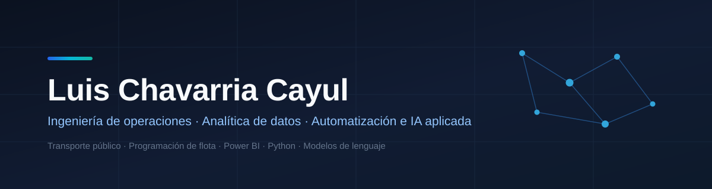

  

---

## Qué hago

Ingeniero Civil Industrial con más de 15 años en planificación y optimización de operaciones de
transporte público. Mi trabajo está en la intersección de tres cosas:

- **Operación real**: programación de flota y turnos, indicadores normativos de calidad y
  electromovilidad, en entornos regulados y de alta complejidad.
- **Datos**: modelamiento analítico, construcción de indicadores y tableros que se usan para
  decidir, no solo para mirar.
- **Automatización e IA aplicada**: usar modelos de lenguaje y pipelines propios para acelerar
  análisis, documentación y procesos, con validación numérica de por medio.

Me interesa un punto en particular: que los números cuadren. Los indicadores se contrastan contra
una segunda fuente cuando existe, los criterios y topes quedan documentados, y el resultado se puede
reproducir.

---

## Proyectos

### Simulador operacional de flota eléctrica

Simula la operación diaria de una flota de buses eléctricos y responde una pregunta concreta de
ingeniería: si la infraestructura de carga alcanza para cumplir la programación, y cuánta energía
hay que cargar de noche. Modela autonomía, estado de carga, colas de cargadores por terminal y la
verificación de la jornada siguiente.

`Python` · `Streamlit` · `Plotly` · `pandas`

[**Abrir demostración interactiva**](https://luisalbertochavarria.github.io/simulador-flota-electrica/) ·
[Código](https://github.com/luisalbertochavarria/simulador-flota-electrica)

### Dashboard operacional y económico

Modelo analítico y tablero para el seguimiento de una unidad de transporte: kilómetros,
expediciones, flota requerida, ingresos teóricos e indicadores de calidad. Incluye explorador de
escenarios y una tabla de sensibilidad que cuantifica cuánto cuesta cada punto de incumplimiento.

`Power BI` · `DAX` · `Power Query` · `Python`

[**Abrir réplica interactiva**](https://luisalbertochavarria.github.io/dashboard-operacional-powerbi/) ·
[Código](https://github.com/luisalbertochavarria/dashboard-operacional-powerbi)

### Pipeline de OCR y traducción de documentos

Sistema web que convierte PDF a Markdown y traduce documentos y manga conservando la estructura:
títulos, tablas, fórmulas y bloques de código nunca se envían al traductor. Procesamiento
totalmente local.

`Python` · `FastAPI` · `PyMuPDF` · `CTranslate2` · `LLM local`

[Código](https://github.com/luisalbertochavarria/pipeline-traduccion-ocr) ·
[Lista completa de proyectos](https://github.com/luisalbertochavarria/portafolio-ia)

---

## Herramientas

---

## Cómo trabajo

**Validación antes que resultado.** Un número sin contraste no sirve para decidir. Los indicadores
se cruzan contra una fuente independiente cuando existe, y las diferencias quedan a la vista.

**Datos sintéticos cuando corresponde.** Los proyectos que parten de información contractual o de
terceros se publican con datos ficticios generados, para que cualquiera pueda ejecutarlos sin
exponer información sensible.

**Local cuando importa la privacidad.** Los modelos de lenguaje y de traducción pueden correr
enteramente en la máquina, sin enviar documentos afuera.

**Documentación dentro del producto.** Los criterios, fórmulas y topes quedan explicados en el
propio tablero, para que el modelo se entienda sin depender de quien lo construyó.

---

**Contacto** · [LinkedIn](https://www.linkedin.com/in/luischavarriacayul/) ·
[Portafolio](https://github.com/luisalbertochavarria/portafolio-ia)

